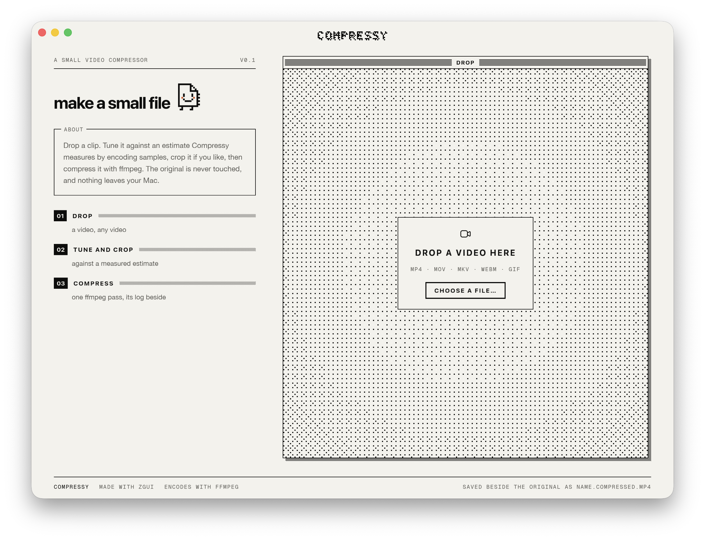
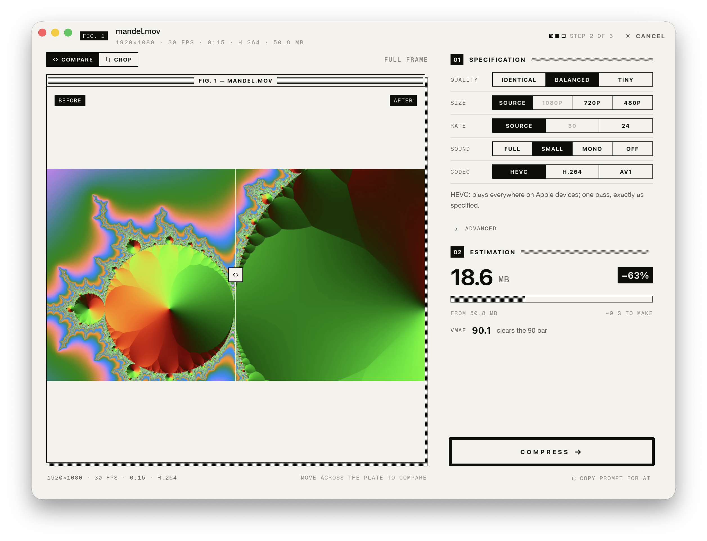
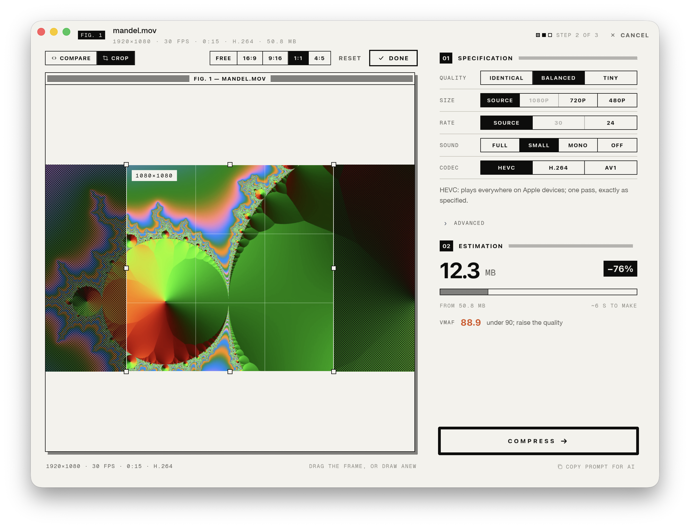
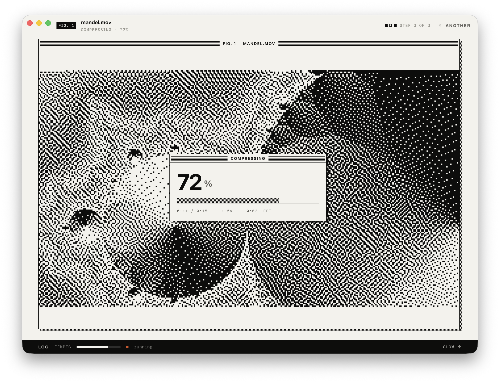
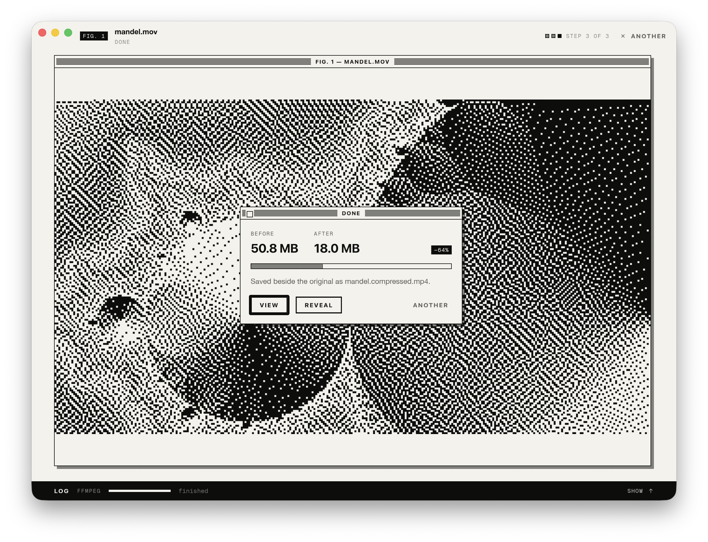

# Compressy

A small macOS app built with [zgui](https://github.com/zeronsh/zgui): drop a video in, crop it,
tune the settings against a measured estimate, and compress it with ffmpeg.

<p align="center">
  
</p>

<table>
  <tr>
    <td width="50%"></td>
    <td width="50%"></td>
  </tr>
  <tr>
    <td align="center"><sub>Review: tune against a measured estimate, split before and after</sub></td>
    <td align="center"><sub>Crop: drag a box, or pick an aspect; the estimate follows</sub></td>
  </tr>
  <tr>
    <td width="50%"></td>
    <td width="50%"></td>
  </tr>
  <tr>
    <td align="center"><sub>Compressing: one ffmpeg pass, its log in a drawer</sub></td>
    <td align="center"><sub>Done: saved beside the original</sub></td>
  </tr>
</table>

## Install

```sh
brew install ffmpeg zig@0.16   # ffmpeg does the encoding; Zig builds Ghostty, the log's terminal
scripts/bundle.sh --install    # builds Compressy.app (and a .dmg in dist/), puts it in /Applications
```
